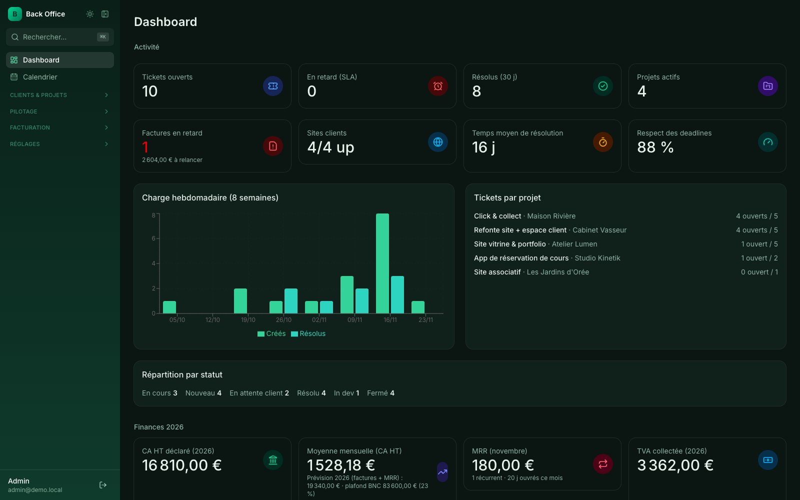
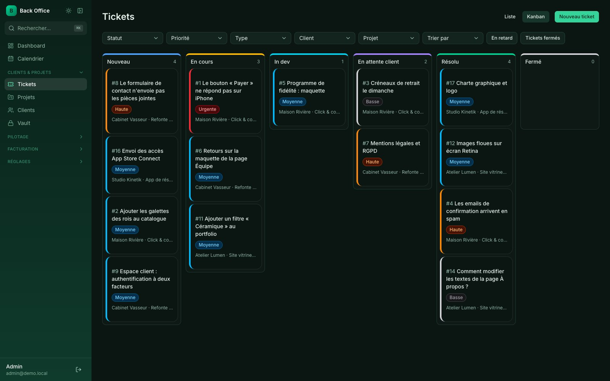
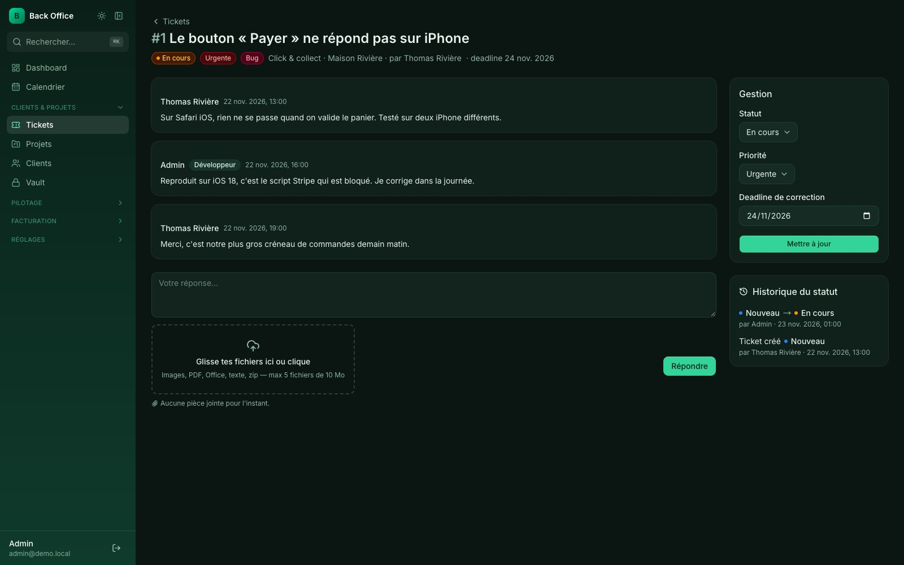
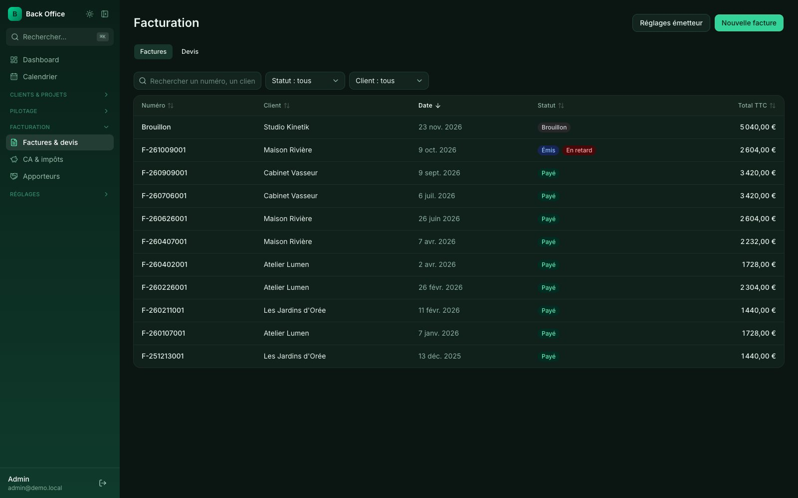
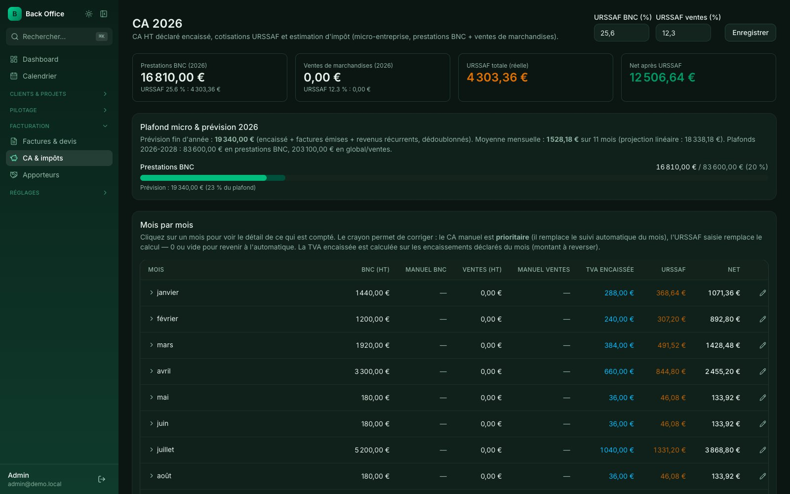
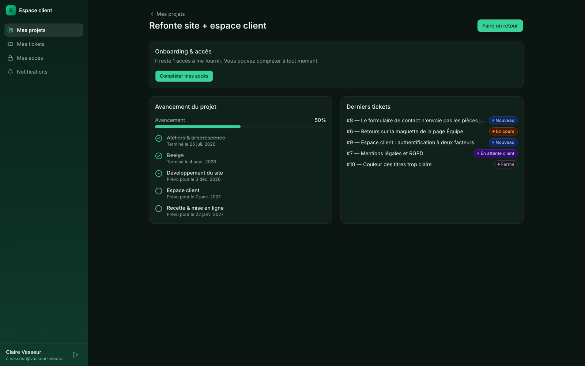
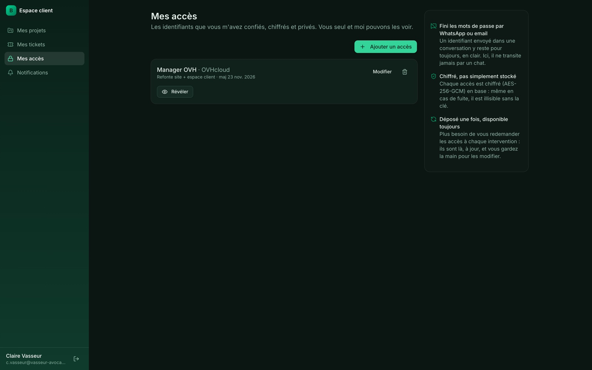
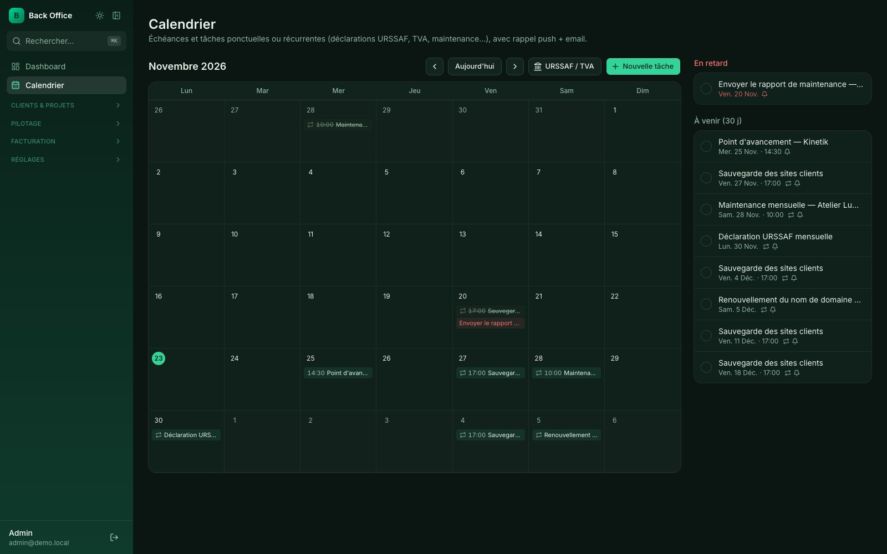

# Freelance Hub

> Back-office auto-hébergé pour développeurs freelance : tickets clients, portail client, factures & devis, suivi URSSAF — avec une API REST et un serveur MCP.

<picture>
  <source media="(prefers-color-scheme: light)" srcset="docs/screenshots/dashboard-light.jpg">
  
</picture>

Un seul outil pour gérer ses clients au lieu de jongler entre un Trello, un Google Drive, un tableur de facturation et des mails perdus. Le client a son propre espace pour remonter des bugs, suivre l'avancement et transmettre ses accès ; le freelance pilote tout depuis un cockpit admin.

## Aperçu

| Kanban des tickets | Fil d'un ticket |
|---|---|
|  |  |
| **Factures & devis** | **CA & URSSAF** |
|  |  |
| **Portail client : suivi du projet** | **Portail client : accès chiffrés** |
|  |  |

**Calendrier : tâches récurrentes et échéances URSSAF / TVA**



## Fonctionnalités

**Côté client (portail)**
- Tickets (bug, retour design, évolution, question) avec captures d'écran et fil de discussion
- Suivi du projet : jalons, timeline, progression
- Onboarding guidé et formulaire de besoins
- Vault : transmission chiffrée des accès (hébergeur, DNS, CMS…)
- Notifications email et push (PWA installable)

**Côté admin (cockpit)**
- Kanban des tickets, SLA automatiques par priorité (jours ouvrés), historique des statuts et des révisions
- Clients, projets, versions de facturation, invitations par lien
- Factures & devis en PDF, numérotation, relances automatiques des factures en retard
- Finance micro-entreprise : CA BNC / ventes, cotisations URSSAF estimées, revenus récurrents (MRR)
- Calendrier : tâches ponctuelles ou récurrentes (maintenance, renouvellements…) et échéances URSSAF / TVA mensuelles ou trimestrielles, avec rappels email + push
- Apporteurs d'affaires et calcul des commissions
- Suivi du temps, monitoring de disponibilité des sites clients, journal des connexions
- Rôle « mainteneur » limité aux projets qui lui sont assignés
- Recherche globale, thème clair/sombre, palette personnalisable

**Pour l'automatisation**
- API REST `/api/v1` avec clés à scopes (`tickets:read`, `tickets:write`, `finance:read`…) et isolation multi-tenant — voir [`apps/backoffice/docs/agent-api.md`](apps/backoffice/docs/agent-api.md)
- Serveur MCP (`packages/mcp-server`) pour piloter ses tickets depuis n'importe quel client MCP (assistant IA, IDE…)

## Stack

Next.js 16 (App Router, Server Actions) · React 19 · TypeScript · Prisma + PostgreSQL · Better Auth · Tailwind CSS 4 + shadcn/ui · Resend · Cloudinary · Vitest · Turborepo

## Démarrage rapide

### Avec Docker (le plus simple)

```bash
git clone https://github.com/Bilal-Tech18/freelance-hub.git
cd freelance-hub
DEMO_DATA=true docker compose up -d
```

L'app tourne sur http://localhost:3001 avec sa base Postgres. Connexion : `admin@demo.local` / `demo-admin-2026`.

- Les migrations passent à chaque démarrage ; les secrets (`BETTER_AUTH_SECRET`, `VAULT_ENCRYPTION_KEY`, `CRON_SECRET`) sont générés au premier lancement et conservés dans un volume.
- `DEMO_DATA=true` charge les données de démo, uniquement sur une base vide.
- Pour configurer (URL publique, mot de passe admin, emails…) : `cp .env.docker.example .env` puis `docker compose up -d`. **En production, change `ADMIN_PASSWORD` et `POSTGRES_PASSWORD`.**

### Sans Docker

Prérequis : Node 20+, une base PostgreSQL.

```bash
git clone https://github.com/Bilal-Tech18/freelance-hub.git
cd freelance-hub
npm install

cp apps/backoffice/.env.example apps/backoffice/.env
# renseigner au minimum DATABASE_URL, BETTER_AUTH_SECRET, ADMIN_EMAIL, ADMIN_PASSWORD

npm run db:migrate --workspace backoffice   # crée les tables
npm run db:seed --workspace backoffice      # crée le compte admin
npm run dev                                 # http://localhost:3001
```

Sans `RESEND_API_KEY`, les emails sont affichés dans la console : pratique en local.

### Données de démo

```bash
npm run db:seed:demo --workspace backoffice
```

Charge 5 clients fictifs, leurs projets, 18 tickets, des factures et devis sur 12 mois, un accès dans le Vault et le monitoring. Le script refuse de tourner si la base contient déjà des clients.

| Rôle | Email | Mot de passe |
|---|---|---|
| Admin | `ADMIN_EMAIL` du `.env` | `ADMIN_PASSWORD` du `.env` |
| Client | `c.vasseur@vasseur-avocats.example` | `demo-client-2026` |
| Mainteneur | `lea@demo.local` | `demo-client-2026` |

### Serveur MCP

```bash
npx turbo build --filter=@backoffice/mcp-server
```

Puis, dans la config de votre client MCP :

```json
{
  "mcpServers": {
    "freelance-hub": {
      "command": "node",
      "args": ["packages/mcp-server/dist/index.js"],
      "env": {
        "BACKOFFICE_API_URL": "http://localhost:3001",
        "BACKOFFICE_API_KEY": "sk_live_…"
      }
    }
  }
}
```

## Déploiement

Un blueprint [Render](https://render.com) est fourni (`render.yaml`) : créer une base Postgres, renseigner les variables marquées `sync: false`, déployer. Les migrations passent en `preDeployCommand`.

L'image Docker (`Dockerfile`) se déploie aussi telle quelle sur tout hébergeur de conteneurs. Sinon, n'importe quel hébergeur Node + Postgres fonctionne : `npm run build --workspace backoffice` puis `npm run db:deploy --workspace backoffice && npm start --workspace backoffice`.

## Sécurité

- Chaque server action et chaque route API vérifie le rôle (`requireAdmin` / `requireUser`) et restreint les requêtes au périmètre de l'utilisateur (`src/lib/authz.ts`).
- Les clés API sont stockées hachées (SHA-256) ; les secrets du Vault sont chiffrés en AES-256-GCM.
- La CI lance gitleaks, un audit des dépendances, le lint, les tests et le build.

Une faille ? Merci de me contacter en privé plutôt que d'ouvrir une issue publique.

## Licence

[MIT](LICENSE) — © Bilal Nhari
